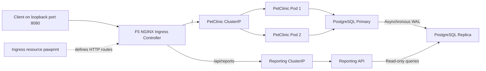

# Project PawPrint · Kubernetes Edition

PawPrint runs two Spring PetClinic Pods, a PostgreSQL 18 Primary and physical hot standby, and an independent Reporting API behind F5 NGINX Ingress. The project runs on a three-node Kind cluster on Ubuntu.

## Architecture



See [architecture and Pod placement](docs/architecture.md) for storage and scheduling details.

## Setup

Run the commands from the project root on an amd64 Ubuntu host with Docker, Kind, kubectl, Helm, Git, Make, Bash, Python 3 and curl. The Deployment manifests pin verified GHCR digests for PetClinic and Reporting. [Host requirements and troubleshooting](docs/deployment-guide.md)

Check `kind get clusters` first. If `pawprint` is absent, create it with the dedicated kubeconfig.

```bash
mkdir -p -m 700 "$HOME/.kube"
kind create cluster --name pawprint --config kind-pawprint.yaml \
  --kubeconfig "$HOME/.kube/pawprint-config" --wait 180s
```

Load the pinned PostgreSQL and NGINX Ingress images into Kind. The PetClinic and Reporting Pods pull their images from GHCR when the requested digest is absent from the node's cache.

```bash
make preflight &&
make secrets &&
bash scripts/load-images.sh postgres &&
make deploy STAGES="primary bootstrap replica" &&
make deploy STAGES="reporting petclinic" &&
bash scripts/load-images.sh ingress &&
make deploy STAGES="ingress network backup" &&
make verify
```

For a different release, set `GHCR_RELEASE` to the `release.json` from a successful GitHub Actions run. For private packages, create the registry Secret with `make ghcr-secret` after the namespace exists and set `GHCR_PULL_SECRET=pawprint-ghcr`. [Release artifacts, private access and worker pull checks](docs/ghcr-deployment.md)

`make secrets` creates `postgres-primary-auth` from four passwords entered at hidden terminal prompts. The [Secret template](k8s/secret.example.yaml) documents the expected keys using placeholders. See [PetClinic resource sizing](docs/deployment-guide.md#petclinic-resource-sizing) for per-Pod CPU and memory measurements and the configured resource budget.

## Verify and test

Keep the PostgreSQL port internal. The browser entry point is `http://localhost:8080/` and the report endpoint is `http://localhost:8080/api/reports/summary`. Run `make test` for live verification and disposable bootstrap tests. See [failure testing](docs/failure-testing.md) before running `make test-failures`.

For the monitoring demo, run `make monitoring` after Ingress is ready, then open Grafana with `make monitoring-ui`. [Monitoring and verification](docs/monitoring.md)

`make restore` verifies a backup in a temporary database. For an operator-confirmed cutover to a recovered database, see the [live recovery runbook](docs/live-recovery.md).

See the [PetClinic image rollout and rollback](docs/petclinic-image-rollout.md) for the two source revisions, the deployment commands and the service availability measurements.

To build and load the applications on the host, use `IMAGE_SOURCE=local` and follow the [local image setup](docs/deployment-guide.md#build-load-and-deploy-locally). For standalone PetClinic, see the [Maven and Docker smoke tests](docs/standalone-petclinic.md). See the [acceptance report](docs/acceptance-report.md) for test results.

## Challenge evidence

Results for the [Project PawPrint challenge](project-pawprint-kubernetes-challenge.pdf).

| PDF section | Result and evidence |
| --- | --- |
| §4 · Run PetClinic | The pinned revision ran directly on the host with Maven and returned HTTP 200. [Build and run](docs/standalone-petclinic.md#build-with-maven-and-run-on-the-host) |
| §§5–6 · PostgreSQL Primary and Replica | Both databases use persistent claims. An owner inserted on Primary was observed on Replica through streaming replication. [Database evidence](docs/acceptance-report.md#database) |
| §7 · Container image | The standalone Docker run returned HTTP 200. Both Kind workers pulled the published GHCR digests. [Docker evidence](docs/standalone-petclinic.md#run-the-kubernetes-image-with-docker) · [Registry evidence](docs/ghcr-deployment.md#verified-release-on-2026-11-20) |
| §8 · Kind, CNI and DNS | Three Ready nodes, HTTP 200 directly between Pods in both directions across workers, and successful Service DNS lookups. [Cluster and network checks](docs/kind-cluster.md#cross-worker-network-and-service-dns-evidence) |
| §§9–10 · Deployment, Service and Ingress | Two Ready PetClinic replicas on separate workers. ClusterIP and Ingress routing, resource sizing and health probes were verified. [Application checks](docs/acceptance-report.md#application) · [Scheduling and anti-affinity](docs/architecture.md#required-and-preferred-pod-anti-affinity) |
| §§11, 14 · Failure scenarios | Pod deletion, replica outage, replication of new data and image rollout have recorded results. **Worker evacuation is pending.** [Failure test evidence](docs/failure-testing.md) · [Worker status](docs/failure-testing.md#worker-evacuation-status) |
| §§12–13 · Reporting | A separate login reads the Replica. The report refreshes every 30 seconds and degrades independently of PetClinic when the Replica is unavailable. [Reporting checks](docs/acceptance-report.md#reporting) |
| §15 · Security | Internal database access, NetworkPolicies and Secret references are in place. The application ServiceAccount could not read Secrets through the API. Kubernetes API-level encryption at rest is disabled in this lab. [Secret RBAC and encryption](docs/database-security.md#secret-access-and-encryption-at-rest) |
| §§16–17 · Deliverables and troubleshooting | The manifests, [setup steps](#setup), and [Secret template](k8s/secret.example.yaml) are in the repository. [Two diagnosed failures and fixes](docs/troubleshooting.md#observed-failures-and-fixes) |
| §19 · Bonuses | [Monitoring with Prometheus and Grafana](docs/monitoring.md), [Rolling update and rollback](docs/petclinic-image-rollout.md#observed-upgrade-and-rollback), [GitHub Actions image publication with operator-run deployment](docs/ghcr-deployment.md#verified-release-on-2026-11-20) and [Database HA scope](docs/database-architecture.md#failures-replication-is-not-automatic-failover). |
