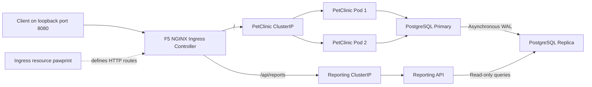

# Project PawPrint · Kubernetes Edition

PawPrint runs two Spring PetClinic Pods, a PostgreSQL 18 Primary and physical hot standby, and an independent Reporting API behind F5 NGINX Ingress. The project runs on a three-node Kind cluster on Ubuntu.

## Architecture



See [architecture and Pod placement](docs/architecture.md) for storage and scheduling details.

## Deploy and verify

Starting without a cluster? Follow the [deployment and test guide](docs/deployment-guide.md) to create the cluster, deploy PawPrint, and run the acceptance tests. See the [acceptance report](docs/acceptance-report.md) for results.

GitHub Actions publishes PetClinic and Reporting to GitHub Container Registry. The [GHCR deployment guide](docs/ghcr-deployment.md) covers release digests, private package credentials, worker pull evidence, and deployment to Kind.

To run PetClinic independently, see the [Maven and Docker smoke tests](docs/standalone-petclinic.md) for commands, HTTP results and screenshots.

```bash
# Run after creating the PawPrint cluster.
make preflight
make secrets
make build
make load
make deploy STAGES="primary bootstrap replica"
make deploy STAGES="reporting petclinic ingress network backup"
make verify
make backup
make restore
make report
```

`make secrets` creates `postgres-primary-auth` from four passwords entered at hidden terminal prompts. The [Secret template](k8s/secret.example.yaml) documents the expected keys using placeholders. See [PetClinic resource sizing](docs/deployment-guide.md#petclinic-resource-sizing) for per-Pod CPU and memory measurements and the configured resource budget.

Keep the PostgreSQL port internal. The browser entry point is `http://localhost:8080/` and the report endpoint is `http://localhost:8080/api/reports/summary`. Run `make test` for live verification and disposable bootstrap tests. See [failure testing](docs/failure-testing.md) before running `make test-failures`.

`make restore` verifies a backup in a temporary database. For an operator-confirmed cutover to a recovered database, see the [live recovery runbook](docs/live-recovery.md).

See the [PetClinic image rollout and rollback](docs/petclinic-image-rollout.md) for the two source revisions, the deployment commands and the service availability measurements.

The nested checkout is Spring PetClinic commit `500158f732419217507c7656904b8e6aa1bcc0d6`. For a new workspace, clone the official repository as `spring-petclinic/` and check out that revision inside the nested repository. The parent ignores that checkout to avoid staging its files or Git metadata.
