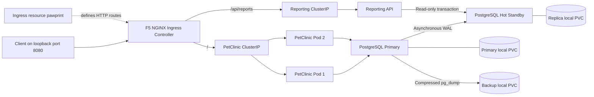

# PawPrint architecture

The live Kind cluster has one control plane and two workers. Its loopback mappings are TCP `8080 → 30080` and `8443 → 30443`. F5 NGINX Ingress Controller 5.8.0 and Helm chart 2.9.0 support the standard Ingress API and list Kubernetes 1.37 as tested. The community ingress-nginx project ended maintenance in March 2026. [F5 compatibility matrix](https://docs.nginx.com/nginx-ingress-controller/changelog/) · [NGINX project status](https://kubernetes.nginx.org/)

PetClinic reads and writes the Primary. The Reporting API keeps one report snapshot in memory and queries only the standby. Each database has its own PVC using the existing `standard` class. Kind containers share laptop resources and the local volumes depend on their assigned nodes. This satisfies the lab's three-node topology with databases inside Kubernetes, an alternative to the assignment's suggested separate VMs.

## PetClinic Pod placement

The Deployment uses a topology spread constraint with `topologyKey: kubernetes.io/hostname`, `maxSkew: 1` and `whenUnsatisfiable: ScheduleAnyway`. The hostnames identify the placement domains. With both workers eligible and enough capacity, the scheduler prefers one PetClinic Pod on each worker. The running deployment had one ready PetClinic Pod per worker during the resource measurements. [Deployment configuration](../k8s/petclinic/deployment.yaml) · [Kubernetes topology spread constraints](https://kubernetes.io/docs/concepts/scheduling-eviction/topology-spread-constraints/)

`ScheduleAnyway` applies that preference as a scheduling score. If a worker is cordoned or otherwise ineligible and Kubernetes needs to place a replacement, the surviving worker can host both replicas as long as it satisfies the Pod's other scheduling requirements and has room for both requests. With both Pods on one worker, losing that worker takes away both application replicas until Kubernetes can replace them. [PetClinic resource sizing](deployment-guide.md#petclinic-resource-sizing) · [Kubernetes topology spread constraints](https://kubernetes.io/docs/concepts/scheduling-eviction/topology-spread-constraints/)
