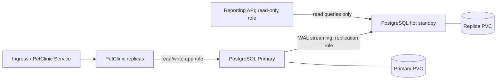

# Project PawPrint database architecture

## Proposed topology

PostgreSQL runs inside the existing three-node Kind cluster per the project owner's environment choice. This differs from the PDF's suggested realistic arrangement of PostgreSQL on two dedicated Linux VMs; the PDF permits a justified alternate topology. Each instance receives an independent PVC on the existing `local-path` StorageClass. `local-path` is node-local storage, not replicated storage.

## Responsibilities and connections

- **Primary** accepts PetClinic writes and reads with a dedicated least-privileged app role. PetClinic `POSTGRES_URL` targets a stable internal ClusterIP Service for the primary pod.
- **Replica** continuously receives primary WAL and serves read-only reporting queries over a separate internal Service. The reporting API uses a distinct read-only account and replica endpoint. Ordinary app traffic never targets it.
- **Replication** uses PostgreSQL physical streaming replication over TCP 5432, `wal_level=replica`, adequate `max_wal_senders`, a dedicated replication role, and restricted `pg_hba.conf`. Standby bootstrap uses a base backup and standby configuration (`primary_conninfo`, `standby.signal` for supported versions). A replication slot can prevent WAL removal while a replica is disconnected, but retained WAL can consume disk; define monitoring and cleanup behavior before using one.
- **Authentication** separates app, replication, and reporting identities. Supply credentials through Kubernetes Secrets at deployment time; never commit populated Secret YAML or passwords. Restrict DB paths to app→primary, reporting→replica, and replica→primary replication. Database Services remain ClusterIP only.

PetClinic's existing PostgreSQL profile includes JDBC support, SQL resources, and environment-variable datasource settings; source changes are not required for app-to-primary connectivity. Reporting is a separate concern and should be its own small API/component because the checkout has no reporting endpoint.

## Persistence and scheduling

Manage each DB pod with a StatefulSet and its own PVC. Confirm the existing `local-path` StorageClass name, provisioner, reclaim behavior, and volume binding before deployment. A local-path volume is not replicated and may be tied to a node. If that worker fails, the volume may be unavailable to a replacement pod on the other worker; scheduling can remain Pending. Pod restart persistence does not protect against node or disk loss. Separate primary and replica PVCs do not provide storage replication.

Use database-aware startup/readiness/liveness checks, resource requests/limits, and topology spread or anti-affinity to separate primary and replica across workers. With only two workers, a worker failure can leave reduced capacity or make node-local data unavailable. Validate PVC events and node affinity before failure exercises.

## Replication proof

On primary, inspect `pg_stat_replication`; on standby, inspect `pg_stat_wal_receiver` and `pg_is_in_recovery()`. Record receive/replay positions and lag. Acceptance proof: insert a unique owner or pet through primary, then query it on standby and compare record identity/count after replay. Streaming is asynchronous by default, so visibility can lag and acknowledged writes may be lost if primary fails before WAL reaches the standby unless synchronous replication is explicitly configured.

## Failures: replication is not automatic failover

Streaming copies WAL; it does not elect/promote a new primary, move the write Service, fence the old primary, or guarantee zero data loss. If primary fails, PetClinic writes fail. The replica remains standby until an operator confirms the old primary is fenced, promotes the replica, and intentionally switches the write endpoint. Preventing split brain and rejoining/rebuilding the old primary require a runbook. This is **manual promotion**, not automatic HA.

The assignment requires streaming replication and asks about lag/disconnection. It does not require automated PostgreSQL failover or Patroni; the PDF identifies better PostgreSQL HA as bonus/investigation work. Recommendation: implement primary + streaming standby + documented manual recovery first. Do not claim two DB instances provide automatic HA.

## Security and unresolved decisions

Keep DB Services internal. Use Secret-injected credentials, distinct DB roles, least privilege, restricted `pg_hba.conf`, and the verified kindnet NetworkPolicies. Reporting failure should affect reporting only.

Earlier design decisions tracked in the deployment and replication guides: (1) pinned PostgreSQL image/version and supported replication bootstrap; (2) PVC sizes and local-path behavior; (3) whether to use a replication slot and WAL retention safeguards; (4) Reporting API runtime, queries, 30-second schedule, timeouts and degraded response; (5) safe one-time schema/data initialization with two app replicas; (6) manual promotion/recovery procedure including endpoint switch and old-primary rejoin.

## Backup and bootstrap

The public-schema logical dump and its source snapshot manifest are written to the dedicated backup PVC. Restore verification uses an isolated PostgreSQL Job and checks the archive against that manifest. An advisory-locked, version-marked transaction provisions a new database before PetClinic starts. See [backup and restore](backup-restore.md) and [database testing](database-testing.md).
