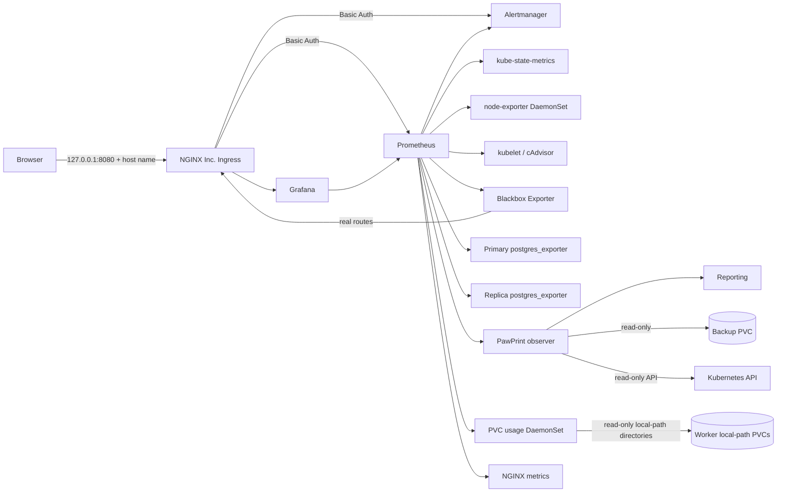

# PawPrint monitoring and observability

PawPrint runs a small, persistent monitoring platform inside the Kind cluster. It observes the application, PostgreSQL Primary/Replica pair, Kubernetes workloads, nodes, NGINX Inc. Ingress, local-path storage, backups and restore-test evidence. Monitoring is isolated from the application data path: an exporter failure cannot stop PetClinic or PostgreSQL.

## Architecture



All Services are `ClusterIP`. No monitoring Service is `NodePort` or `LoadBalancer`. Normal UI access uses the existing NGINX Inc. controller and Kind mapping `127.0.0.1:8080 -> 30080`; port-forward is not part of the workflow.

## Components and permissions

| Component | Purpose | Persistence / permission |
| --- | --- | --- |
| Prometheus | 15-second scraping, seven-day/1500 MB capped TSDB and alert evaluation | 2 GiB local-path PVC; read-only discovery plus kubelet metrics RBAC |
| Alertmanager | Groups alerts and exposes the local operator UI | 256 MiB local-path PVC; no Kubernetes API token |
| Grafana | Provisioned datasource and dashboards | 512 MiB local-path PVC; no Kubernetes API token |
| Blackbox Exporter | HTTP status, availability and latency through actual Ingress routes | No API token or persistent state |
| kube-state-metrics | Cluster object state; dashboard queries select PawPrint and local-path-storage | Dedicated ServiceAccount, list/watch only, and no permission on Secrets |
| node-exporter | CPU, RAM, filesystem and uptime on all three Kind nodes | Read-only host filesystem mount; no API token |
| kubelet/cAdvisor | Container CPU and memory and kubelet volume metrics when supported | Scraped with Prometheus ServiceAccount token |
| postgres_exporter | Primary and Replica database statistics and custom HA queries | `monitoring_user`, `pg_monitor`, connection limit 4; no write privileges |
| PawPrint observer | Reporting JSON semantics plus backup checksum/Job/restore evidence | Read-only backup PVC and get/list-only Kubernetes API RBAC |
| PVC usage collector | Actual allocated bytes for each PawPrint local-path PVC plus backing-filesystem size/free bytes | One Pod per worker; read-only local-path mount, no API token, only `DAC_READ_SEARCH` for PostgreSQL directories |

The PostgreSQL HBA permits only `monitoring_user` from the Pod CIDR. NetworkPolicies permit the exporters to reach their matching database only. The role is not a superuser and monitoring never receives PetClinic application credentials.

## Deploy

Deploy after application, database, Ingress, network policy and backup stages are healthy:

```bash
make deploy-monitoring
make verify-monitoring
make monitoring-status
make monitoring-ui
```

`make monitoring-ui` only prints URLs and the `/etc/hosts` line; it does not start a port-forward. On the first deployment, `.pawprint/monitoring-credentials.env` is created with mode `0600` and ignored by Git. Override generated values before the first run if required:

```bash
MONITORING_USERNAME=pawprint-admin \
MONITORING_PASSWORD='choose-a-strong-password' \
POSTGRES_MONITORING_PASSWORD='choose-another-password' \
make deploy-monitoring
```

The database monitoring role requires two new HBA entries. Because PostgreSQL mounts the HBA ConfigMap with `subPath`, the first deployment recreates the Replica and then the Primary Pod in that order. It checks streaming before moving to the Primary. PVCs are retained. Later monitoring updates do not repeat this if the live HBA already contains the role.

## Ingress URLs and authentication

Add this line to `/etc/hosts` if the host resolver does not resolve these lab names:

```text
127.0.0.1 grafana.pawprint.local prometheus.pawprint.local alertmanager.pawprint.local
```

| UI | URL | Protection |
| --- | --- | --- |
| Grafana | `http://grafana.pawprint.local:8080/` | Grafana login; anonymous access disabled |
| Prometheus | `http://prometheus.pawprint.local:8080/` | NGINX Inc. Basic Auth |
| Alertmanager | `http://alertmanager.pawprint.local:8080/` | NGINX Inc. Basic Auth |

The NGINX Secret contains an htpasswd hash. Grafana and PostgreSQL monitoring passwords are Kubernetes Secrets. No password is committed in YAML or a ConfigMap. These HTTP endpoints are loopback-only because the Kind host mappings bind to `127.0.0.1`; production would additionally require TLS.

Some shells define an HTTP proxy. Use `NO_PROXY=127.0.0.1,.pawprint.local` or `curl --noproxy '*'`; otherwise a proxy-generated 503 can be mistaken for an Ingress failure.

## Dashboards

All dashboards are JSON provisioned from the repository and survive Grafana Pod replacement.

1. **PawPrint Overview** — application routes, nodes, PostgreSQL roles/stream, Reporting freshness, PVCs, backup age and firing alerts.
2. **PawPrint Kubernetes Cluster** — Ready nodes, Pod phases/restarts, workload replicas, node CPU/RAM and container working sets.
3. **PawPrint PostgreSQL High Availability** — database availability, Primary/Replica role correctness, streaming, WAL lag, connections, commits/rollbacks, cache hit ratio and WAL message/replay age.
4. **PawPrint Application Health** — PetClinic/Reporting availability, status, latency, readiness, restarts and Reporting semantics.
5. **PawPrint Ingress and Network** — controller target/reload health, real application/monitoring route probes, observed status/latency and controller request rate.
6. **PawPrint Storage and Persistence** — PVC phase/requested capacity, provisioner readiness, actual logical database size, actual mounted backup filesystem use and PV binding.
7. **PawPrint Backup and Recovery** — latest archive age, SHA256 integrity, verified files, active/failed Jobs, next schedule and latest restore-test outcome.
8. **PawPrint HTTP health** — the original compact availability/status/latency dashboard retained for the presentation.
9. **PawPrint SRE / SLO** — current, 24-hour and seven-day route availability, HTTP error rate, latency percentiles and remaining error budget.
10. **PawPrint PostgreSQL Performance** — active/long-running work, connection saturation, locks, TPS, database growth, cache, deadlocks, checkpoints and WAL activity.
11. **PawPrint Kubernetes Resource Efficiency** — actual CPU/RAM versus requests and limits, saturation, throttling, OOM evidence and top Pods.
12. **PawPrint Alerts and Incidents** — firing alerts by severity, current pending/firing duration, retained state transitions and runbook dashboard links.

The Storage dashboard deliberately does not turn an unavailable metric into zero. This Kind/local-path setup does not expose `kubelet_volume_stats_*`, so a read-only worker DaemonSet measures allocated blocks below each `/var/local-path-provisioner/..._pawprint_<claim>` directory. It reports actual directory usage separately for Primary, Replica, backup, Prometheus, Grafana and Alertmanager. Backing-filesystem size/free bytes are explicitly labeled as node filesystem metrics, not PVC capacity. The requested PVC size remains a scheduling/capacity budget: local-path does not enforce it as a hard quota. PostgreSQL logical database size is also shown separately from physical directory use.

NGINX Inc. has Prometheus metrics enabled but latency metrics disabled in the existing Helm release. Controller reloads, connections and total requests are available. Per-route status and latency use Blackbox probes. The dashboard does not query unsupported `location_zone` series.

### SLO definition

The presentation SLO is explicit: **each public application route (`PetClinic` and `Reporting`) returns HTTP 200 for at least 99.5% of probes over 30 days**. A non-200 probe consumes the 0.5% error budget. The dashboard shows current, 24-hour and seven-day evidence plus a seven-day error-budget view. Prometheus currently retains only seven days (or 1500 MB), so it cannot yet prove a full 30-day window; the 30-day objective is documented rather than silently replacing it with a shorter target. Blackbox latency is synthetic end-to-end latency through Ingress. Because the installed NGINX metrics do not expose a request-duration histogram, P50/P95/P99 are calculated from probe duration, not claimed as server-side NGINX percentiles.

## Collected metrics

- Kubernetes object state: nodes, Pods, readiness, waiting/termination reasons, restarts, Deployment/StatefulSet replica state, Jobs/CronJobs, PVC/PV and local-path provisioner.
- Node and container: CPU, memory, uptime, filesystem availability, cAdvisor container CPU and working set, CPU throttling, OOM termination evidence, and requests/limits through kube-state-metrics.
- Storage: local-path directory allocated bytes for all PawPrint PVCs, requested size, PV node affinity, and backing-node filesystem size/free bytes. These are intentionally different metric families.
- PostgreSQL: `pg_up`, grouped connection state, transactions, database/table size, cache I/O, locks, deadlocks, long transactions, PostgreSQL 18 checkpointer statistics and custom role/stream/byte-lag/message-age/WAL receipt-replay gauges.
- Reporting: `stale`, `degraded`, `replayPendingBytes`, `generatedAt`, `dataFreshnessAt` and `lastWalMessageAt` converted to gauges/timestamps.
- Backup: latest timestamp and archive identity, SHA256 integrity, verified file count, filesystem bytes, active/failed Job count, latest restore-test identity/result and its independent timestamp.
- Ingress/application: Blackbox success, status and duration through NGINX plus NGINX controller health/request metrics.

`dataFreshnessAt` is the last replayed transaction time and may remain unchanged while the database is idle. `lastWalMessageAt` proves receiver communication and is evaluated separately; the dashboard and alerts do not treat idle replay time alone as failure.

## Alerts

Prometheus loads 28 version-controlled rules with `critical`, `warning` or `info`-style operational annotations and a suggested action. Rules cover node readiness/CPU/RAM/filesystem, CrashLoopBackOff, image pulls, repeated restarts, OOMKilled, unschedulable Pods, Deployment/StatefulSet mismatches, PVC state and actual usage budget, actionable application/database CPU throttling, target health, Primary/Replica availability, streaming/lag, Reporting stale/degraded, PetClinic/Reporting/monitoring Ingress, backup failure/overdue/integrity and overdue restore verification. Backup overdue is seven hours for the six-hour schedule. Replication checks use receiver connectivity and byte lag, so an idle database does not create a false failure.

Alertmanager intentionally has only the `local-ui` receiver. No imaginary Slack, email or Telegram credential is configured. Add a real receiver and routing Secret later; until then alerts are visible in Prometheus, Alertmanager and Grafana.

## Verification and observed evidence

`make verify-monitoring` checks all PVCs, all Service endpoints, unauthenticated rejection, authenticated host-based Ingress access, all provisioned dashboards, all Prometheus targets, representative Kubernetes/node/cAdvisor/PostgreSQL/replication/Blackbox/backup series and application/database regressions.

Observed on 2026-11-21 after the advanced dashboard pass:

- 21/21 distinct Prometheus `job`/`instance` targets were `UP`.
- all 12 dashboards loaded; an automated live audit evaluated 125 PromQL expressions and found zero query errors or current `No data` results.
- Grafana returned 200; Prometheus and Alertmanager returned 401 without credentials and healthy responses with credentials.
- backup `petclinic-20261120T202633Z-...` passed four SHA256 checks; the latest retained restore-test Job was successful.
- PetClinic and Reporting returned HTTP 200; Reporting was `stale=false`, `degraded=false`, `replicaStatus=streaming`.
- Primary was writable, Replica was in recovery and custom replication streaming was 1.
- actual directory measurements were exported for all six bound PawPrint PVCs; Primary and Replica measured 83,140,608 and 66,396,160 allocated bytes respectively. The measurement is deliberately not presented as a local-path quota.
- after controlled Grafana/Prometheus Pod replacement, PVC UID/PV mappings were unchanged, all dashboards remained, and Prometheus retained samples 600 seconds older than the replacement Pod.
- one legitimate `LowNodeFilesystem` warning fired because `/var` was 91% used (about 16 GiB available). This is host capacity pressure, not a dashboard error.

Evidence logs are stored in ignored runtime paths under `.pawprint/evidence/monitoring/`.

## Resource budget and logging decision

Before the advanced additions, the namespace-wide Prometheus snapshot reported about 2.30 GiB RAM requests, 1.10 GiB working set, 1.20 requested CPU cores and 0.074 used CPU cores. That snapshot included retained completed-workload series, so it is evidence of the observation point rather than a scheduler-capacity total. The only new continuously running component is the two-Pod PVC collector DaemonSet: together it adds exactly **48 MiB RAM and 20m CPU requests** (128 MiB/200m limits). Dashboards, Prometheus rules and extra scrape/custom-query configuration do not add Pods. After deployment the host still had about 3.2 GiB available RAM; `/var` remained the binding constraint at 91% used. Observed working-set and CPU fluctuate with scrape and application activity. Raw before/after snapshots are retained under `.pawprint/evidence/monitoring-advanced/`.

Loki and Alloy were evaluated but intentionally not deployed. RAM had headroom, but `/var` was already 91% full, swap was in use, and a real filesystem warning was firing. A new persistent log store would add disk write amplification and retention pressure at the wrong time. The bounded alternative is:

```bash
SINCE=15m TAIL_LINES=200 make monitoring-logs
```

It reads recent PetClinic, Reporting, PostgreSQL, NGINX and monitoring logs without mutating workloads or storing another copy. Central logging can be reconsidered after host storage is expanded or safely cleaned and an explicit Loki retention/size budget is agreed. Tempo is not deployed because the applications are not instrumented for tracing and metrics plus targeted logs satisfy the current acceptance goal.

## Persistence and limitations

Prometheus retains seven days or 1500 MB, whichever comes first. Grafana and Alertmanager use their own local-path PVCs. Database, backup and monitoring data sets are node-local: a Pod can restart on its PV's node, but the data cannot transparently move to another worker. Losing that Docker Kind node can make its PVC unavailable. This lab intentionally does not introduce distributed storage.

The current NGINX Inc. metric set has no per-route status-class counters or request-duration histogram. The Ingress dashboard therefore shows controller-wide request rate and uses separate Blackbox series for each route's observed status and latency; it does not invent per-route 4xx/5xx rates or server-side latency. Alert transition panels use Prometheus-retained `ALERTS_FOR_STATE`; durable resolved-incident history requires an external event/incident store. OOM panels truthfully show no event when no OOM has occurred.

The Metrics API is not installed because Prometheus/cAdvisor already supplies resource monitoring and adding metrics-server would be redundant for this requirement. Consequently `kubectl top` is unavailable; use the Kubernetes dashboard or Prometheus queries.

## Troubleshooting

```bash
make monitoring-status
make verify-monitoring
kubectl --kubeconfig "$HOME/.kube/pawprint-config" --context kind-pawprint \
  -n pawprint get pods,pvc,ingress,endpoints
```

- **503 only from curl:** bypass the workstation proxy with `--noproxy '*'`.
- **ImagePullBackOff:** inspect Pod events. This lab uses Liara mirrors for kube-state-metrics, node-exporter, postgres_exporter, Alertmanager and Grafana where direct registries returned 403.
- **PostgreSQL exporter down:** check matching NetworkPolicy, `monitoring_user` HBA entry and exporter logs; do not substitute a superuser.
- **Backup collector down:** verify the latest archive is group-readable by GID 10001 and inspect observer traceback.
- **No dashboard data:** first inspect Prometheus `/targets`, then run the repository query audit through `make verify-monitoring`; do not replace absent storage metrics with zero.
- **Provisioned dashboard did not update:** ensure the Grafana Deployment references the newest hashed dashboard ConfigMap and wait for its rollout.

The NGINX Inc. authentication annotations and metrics behavior follow the [official annotation reference](https://docs.nginx.com/nginx-ingress-controller/configuration/ingress-resources/advanced-configuration-with-annotations/) and [Prometheus metrics guide](https://docs.nginx.com/nginx-ingress-controller/logging-and-monitoring/prometheus/).
